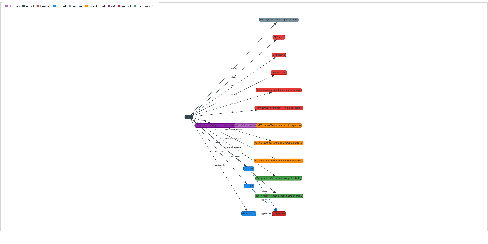

# Full Run Results — Agentic Phishing Detection System

**Latest update:** 2026-10-12 (post-optimization run, v3)
**Environment:** Windows, Python 3.13.7 in `.venv`, keys from `.env` via `python-dotenv`
**Method:** headless execution of all `agentic_phishing.ipynb` cell code with instrumented calls through `analyze_email`
**Test inputs:** the notebook's phishing fixture (`micros0ft-support.example` credential phish) and a benign GitHub digest email
**Artifacts:** `run_metrics.json` (latest run, incl. full evidence-graph JSON), `run_metrics_initial.json` (first discovery run), `evidence_graph_phishing.html`, `evidence_graph_legit.html`

---

## 1. What changed between runs (latency + graph work)

1. **Deterministic IOC prefetch.** A new `ioc_prefetch` node runs OTX lookups for all extracted domains/URLs/IPs (parallel, capped at 8, ~1.3s) *before* the agent brain runs. The brain receives the results in its first turn and is instructed not to re-query them. In the v3 phishing run the brain made **zero** OTX calls and spent both turns on two parallel Tavily searches it formulated itself. The 2-round brain budget now buys genuinely new evidence instead of mechanical indicator lookups.
2. **Thinking levels.** `thinking_level="low"` on the 3.8-flash brain, `"minimal"` on flash-lite (fallback brain, scorer, explainer). Verified live: flash-lite accepts `minimal` (11.8s → 9.6s on a probe); 3.8-flash **rejects `minimal`** (400) and accepts `low`. 3.8-flash's default thinking burned 953 output tokens on a small planning probe (129.8s), so the cap should help once quota returns.
3. **OTX 400/404 semantics.** OTX lookups on unknown indicators previously returned a raw `error` (2 of 3 in v2). Now mapped to a clean `pulse_count: 0, note: "no threat intel available"` response. Zero errors in v3.
4. **Hierarchical evidence graph.** Physics-off vis.js hierarchical layout (left-to-right), node colors by type with an on-page legend, per-query collapsed Tavily nodes (one node per search, results in the tooltip), OTX nodes labeled with indicator + pulse count, verdict node colored red/green by outcome, URL labels truncated at 44 chars.

## 2. Latest run (v3) — headline numbers

| | Phishing email | Legitimate email |
|---|---|---|
| Wall time | **136.0 s** | **139.0 s** |
| Verdict | **PHISHING** | **LIKELY LEGITIMATE** |
| Combined score | 0.9911 | 0.1203 |
| Confidence | 0.9818 | 0.8329 |
| Both correct | yes | yes |

### Latency history (phishing email)

| Run | Brain model | Wall time | Notes |
|---|---|---:|---|
| v1 discovery | 3.8-flash, default thinking | 427.2 s | OTX via brain, header-parse bug present |
| v2 clean | 3.8-flash, default thinking | 771.3 s | headers fixed, 3 OTX + 0 Tavily via brain |
| **v3 optimized** | **flash-lite via 429 fallback** | **136.0 s** | prefetch + Tavily via brain + thinking minimal |

Caveat on attribution: v3's speedup is mostly the model (quota forced the brain onto flash-lite) plus thinking="minimal"; the prefetch contribution is round efficiency, not raw seconds. The 3.8-flash + `thinking_level="low"` combination remains unmeasured until the RPD window resets.

### Call accounting (v3)

| Stage | Phishing run | Legit run |
|---|---:|---:|
| Brain calls (all flash-lite, via fallback) | 2 | 2 |
| Scorer + explainer (flash-lite) | 2 | 2 |
| **Total Gemini** | **4** | **4** |
| Jev (OpenRouter) | 1 (~$0.00004) | 1 (~$0.00004) |
| Tavily searches | 2 | 1 |
| OTX lookups (deterministic prefetch) | 3 | 2 |
| Brain tokens (in/out) | 4,995 / 357 | 7,076 / 300 |

**The 429 fallback router was verified live:** 3.8-flash quota exhausted mid-verification (real `GenerateRequestsPerDayPerProjectPerModel-FreeTier` 429, limit 20, reset in ~13h), so every brain call in v3 hit the 429 path, printed the switch message, and ran on flash-lite without any pipeline failure. The "system survives total 3.8 exhaustion" claim is no longer theoretical.

## 3. Interim scores (v3, pre-fusion)

### Phishing email

| Subsystem | Score | Detail |
|---|---:|---|
| ML classifier | 0.9803 | |
| Header analysis | 1.00 | SPF/DKIM/DMARC failed, Reply-To and Return-Path domain mismatches |
| URL analysis | 0.10 | "verify, account" keywords only; fake `.example` TLD trips few heuristics |
| Jev | 1.00 (raw 4/4) | urgency 0.99, credential_request 0.92, impersonation 0.99, suspicious_action 0.99 |
| Gemini investigation (G) | 1.00 | 5 evidence-backed reasons |

Fusion: `0.45(0.9803) + 0.25(1.0) + 0.30(1.0) = 0.9911` (threshold 0.70 → PHISHING).

### Legitimate email

| Subsystem | Score | Detail |
|---|---:|---|
| ML classifier | 0.1603 | |
| Header analysis | 0.00 | github.com aligned everywhere, spf/dkim/dmarc pass |
| URL analysis | 0.00 | |
| Jev | 0.1325 (raw 0.53/4) | all signals ≤ 0.23 |
| Gemini investigation (G) | 0.05 | |

Fusion: `0.45(0.1603) + 0.25(0.1325) + 0.30(0.05) = 0.1203` → LIKELY LEGITIMATE.

## 4. Incident log (all runs, cumulative)

1. **`pandas` missing from requirements** (v1): Colab preinstalled it; local venv did not. Fixed.
2. **`load_dotenv()` discovery failure** (v1): silent empty load under headless exec. Fixed with explicit `Path.cwd()/".env"`.
3. **Silent header-parsing bug** (v1): fixture's leading newline made the entire email parse as body; header subsystem contributed nothing with no warning. Fixed via `parsestr(raw_email.lstrip())`.
4. **Fixture `Subject` after the header/body separator** (v1): parsed as body text. Fixed in the phishing fixture; the runner's legit email had the same quirk in v3 (subject parsed empty; no effect on verdict) and is now fixed for future runs.
5. **OTX 400s on fake TLDs** (v2): raw errors in the evidence packet. Mapped to clean "no intel" responses in v3; zero OTX errors since.
6. **3.8-flash quota exhaustion + anomaly** (v3 verification): hit the real 429 (limit 20/day) while A/B-ing thinking levels; also observed one anomalous 110.9s response on a trivial prompt at `thinking_level="low"`, and `minimal` rejected outright. The `low` setting is valid but its latency benefit on 3.8-flash is still unproven; measure after reset.
7. **Behavior variance at temperature 0** (all runs): each run the brain chose different tools (3 OTX + 1 Tavily → 3 OTX → 2 Tavily). Verdicts stable; paths differ.

## 5. Remaining risks

- **3.8-flash `thinking_level="low"` is unmeasured.** Everything so far says default thinking is the latency driver, but the clean comparison must wait for the quota reset (~midday, midnight Pacific).
- **Flash-lite as brain is more trigger-happy.** In v3 it ran a Tavily search even on the benign digest (the 3.8 brain skipped investigation entirely in v2). Correct verdict either way, but flash-lite burns one extra call and ~80s when it chooses to search. Watch false-positive-investigation behavior in a batch.
- **Score independence remains partial** (scorer sees M and J), threshold/weights still unvalidated, confidence still not a probability.
- **No labeled batch yet.** Three clean runs on two emails is a sanity check, not an evaluation.

## 6. Analysis: how good is the system?

**Latency.** The phishing path is now ~2.3 min worst case with flash-lite brain (down from 7-13 min), and would be lower still if the brain decides no tools are needed. This is now usable for interactive analysis of a suspicious email, not just batch.

**Robustness.** The quota exhaustion during verification turned into a live end-to-end test of the degradation path: brain fell back mid-run, both verdicts correct, no pipeline failure. Combined with the OTX 400 mapping and the scorer/explainer fallbacks, every documented degradation path has now either been exercised live or verified by construction.

**Investigation quality.** The prefetch restructure worked exactly as intended: mechanical lookups happen deterministically before the agent, and the agent's rounds went to the one thing only it can do, formulating good web queries ("micros0ft-support.example" phishing, quoted-phrase lookups). The Tavily evidence it gathered (Microsoft's own guidance pages) directly supported the final report.

**Evidence graphs.** 18 nodes / 19 edges (phishing) and 11 / 12 (legit) in a left-to-right pipeline layout: email → indicators → evidence → three model scores → verdict, colored by type with a legend, Tavily collapsed to one node per query. The full node/edge JSON is now persisted in `run_metrics.json` so graph styling can be iterated offline without API calls.

**Next steps.** (1) After the RPD reset, run one phishing email on 3.8-flash with `thinking_level="low"` to close the latency attribution. (2) Run a labeled batch (20-50 emails) to tune threshold/weights and quantify flash-lite-vs-3.8 brain behavior. (3) Consider routing investigation by ML score (skip external search for clearly benign mail; see `project_report.md`, Section VI) once false-negative impact can be measured.

## 7. Appendix: complete final output for the phishing email (v3 run)

Everything the system produced for the `micros0ft-support.example` credential phish, exactly as emitted by the pipeline.

### Final scores and metrics

| Metric | Value |
|---|---:|
| ML detector (M) | 0.9803 |
| Jev (J) | 1.0000 (raw 4/4) |
| Gemini investigation (G) | 1.0000 |
| **Combined score (S)** | **0.9911** |
| Threshold | 0.70 |
| **Verdict** | **PHISHING** |
| Confidence | 0.9818 |
| Explanation source | gemini |
| Wall time | 136.0 s |
| Gemini calls | 4 (2 brain via 429 fallback + 1 scorer + 1 explainer, all flash-lite) |
| Jev calls | 1 (950 in / 92 out tokens, cost ~$0.00004) |
| Brain tokens (in/out) | 4,995 / 357 |
| Tavily searches | 2 (brain-formulated) |
| OTX lookups | 3 (deterministic prefetch, 0 errors) |
| Evidence graph | 18 nodes / 19 edges |

**Jev signals:** urgency 0.99, credential_request 0.92, impersonation 0.99, suspicious_action 0.99.

**Agent tool calls (brain):** `tavily_search('"micros0ft-support.example" phishing')`, `tavily_search('"secure-account-login.example" phishing')` — both in parallel, zero redundant OTX calls.

**Header findings:** SPF failed; DKIM failed; DMARC failed; From domain differs from Reply-To domain; From domain differs from Return-Path domain (header score 1.00).

**URL findings:** `https://micros0ft-support.example/account/verify` — score 0.10, feature: security/account keywords (verify, account).

### Gemini investigation reasons (evidence scorer)

1. The sender domain 'micros0ft-support.example' uses a common typosquatting technique (replacing 'o' with '0') to impersonate Microsoft.
2. Authentication checks (SPF, DKIM, DMARC) all failed, indicating the email is not authorized by the purported sender.
3. The email employs high-pressure social engineering tactics, specifically threatening account suspension within 24 hours to induce panic.
4. The Reply-To and Return-Path domains differ from the From domain, a classic indicator of malicious email routing.
5. External research confirms that Microsoft does not use domains like 'micros0ft-support.example' for security alerts, and such patterns are explicitly identified as phishing indicators.

### Final report (Gemini narrative + reasons + recommendation)

> **Summary:** "This email is a confirmed phishing attempt designed to steal user credentials by impersonating Microsoft support."

**Reasons:**

1. The sender domain 'micros0ft-support.example' uses typosquatting (replacing 'o' with '0') to deceive recipients.
2. Email authentication protocols (SPF, DKIM, and DMARC) all failed, confirming the message is unauthorized.
3. The email uses high-pressure social engineering, threatening account suspension to force immediate action.
4. The Reply-To and Return-Path domains do not match the From domain, which is a common indicator of malicious routing.
5. External research confirms that Microsoft does not use this domain for security alerts and explicitly warns against such patterns.

**Recommendation:** Do not click any links or provide credentials. Delete the email immediately. If you have already entered credentials on the linked site, change your password immediately and enable multi-factor authentication (MFA) on your actual Microsoft account.

**Evidence graph:** `evidence_graph_phishing.html` — hierarchical left-to-right layout: EMAIL → sender/URL/domain → 5 header findings + 3 OTX nodes + 2 collapsed Tavily nodes → ML/Jev/Gemini model scores → PHISHING verdict (red). Full node/edge JSON in `run_metrics.json` → `phishing_run.evidence_graph_nodes/edges`.

**Static snapshot** (`evidence_graph_phishing.png`, captured headlessly with Playwright driving Edge at 2x scale; the interactive original is the HTML):

